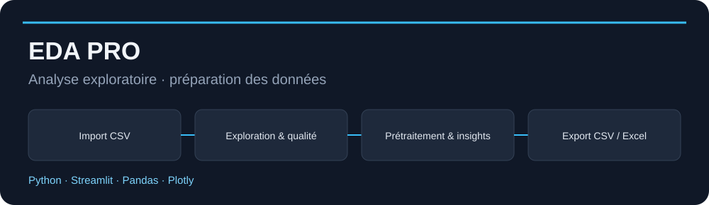

<div align="center">

# EDA PRO



**Analyse exploratoire · préparation des données**

Python · Streamlit · Pandas · Plotly

</div>

## Overview

Application interactive permettant d'explorer, nettoyer et transformer des données tabulaires avant leur exploitation statistique ou en machine learning.

## Fonctionnalités
| Module | Objectif |
| --- | --- |
| Aperçu | Structure, types et comparaison original/nettoyé |
| Visualisation | Histogrammes, boxplots et relations entre variables |
| Qualité | Analyse des valeurs manquantes |
| Prétraitement | Imputation, encodage et mise à l'échelle |
| Insights | Corrélations, variance et valeurs aberrantes |
| Export | CSV, Excel et historique des transformations |

## Architecture
`App.py` coordonne la navigation et l'état de session. Les opérations sont séparées dans `modules/`; le jeu original est conservé séparément des données nettoyées.

## Installation
```bash
python -m venv .venv-local
# Activer l'environnement, puis :
pip install -r requirements.txt
streamlit run App.py
```

## Documentation
Consulter le [rapport technique](rapport.md) pour le détail des méthodes et du cahier des charges.
